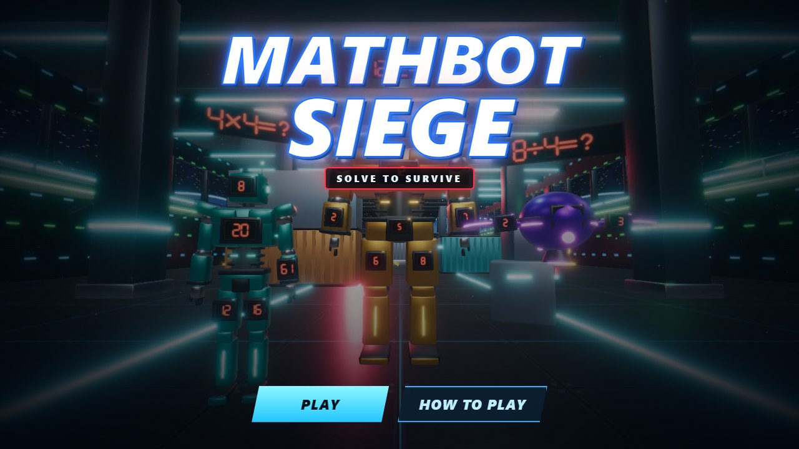
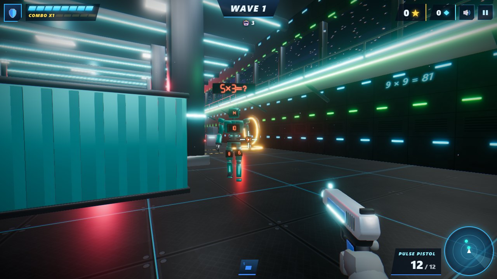
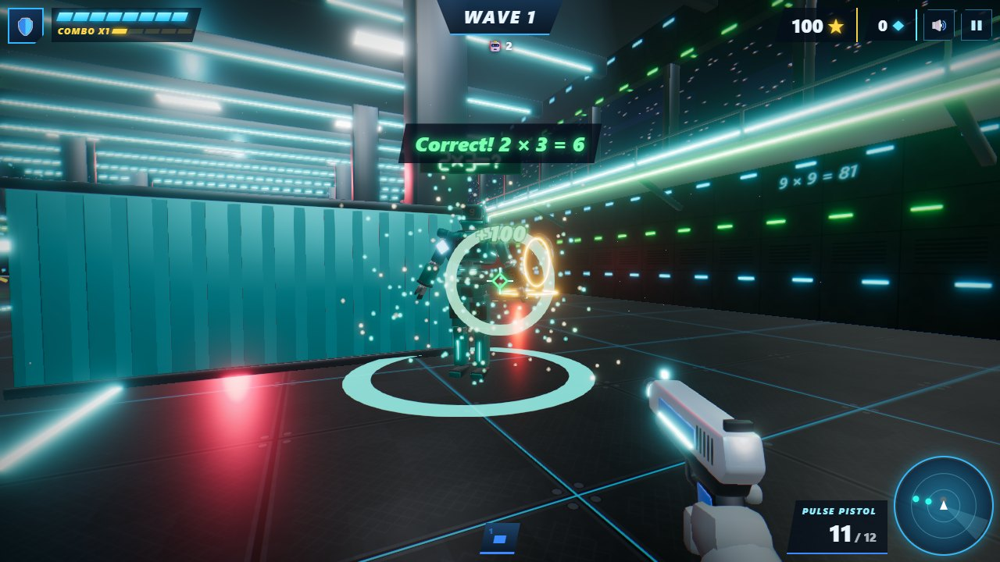
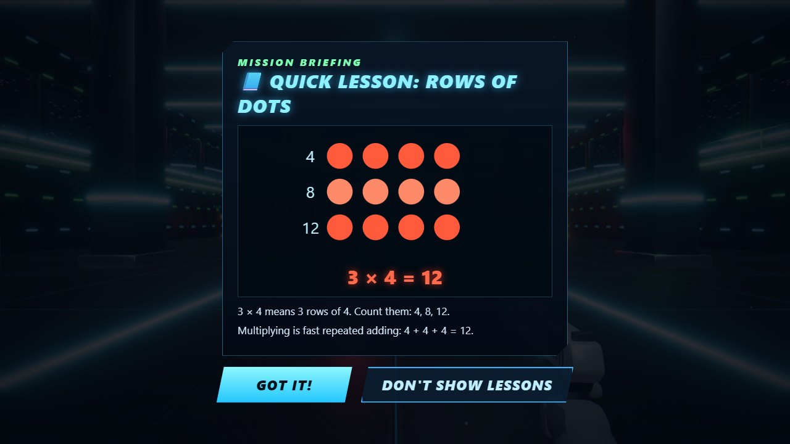
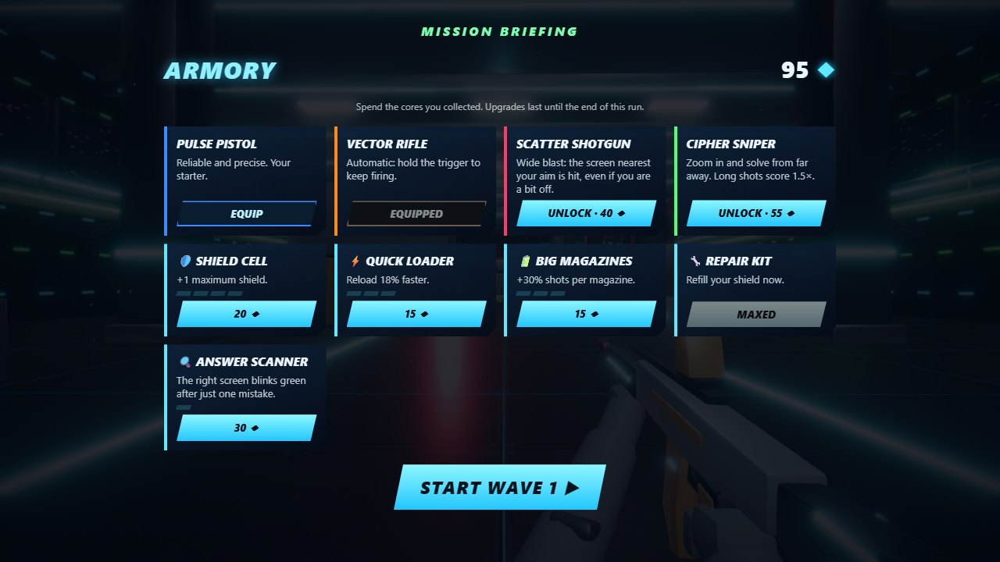
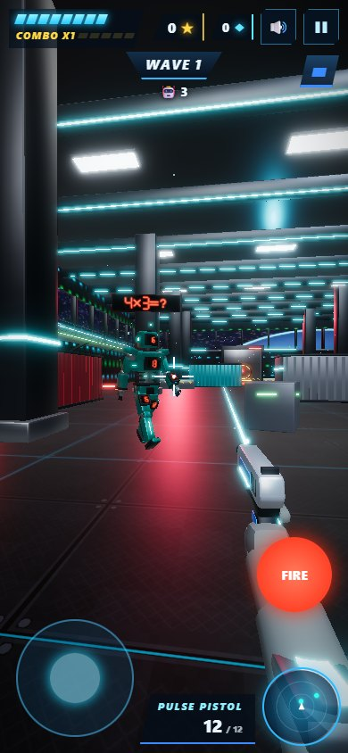
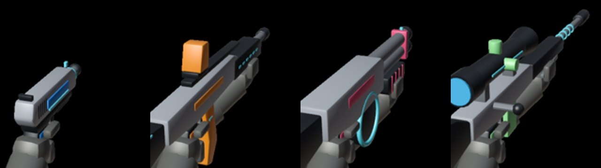

# MathBot Siege

**Solve to survive.** A neon sci-fi first-person math game for the [EdVerse](https://workspace.mexty.ai/edverse/studio) kids' store.

Robots march out of the portals of an orbital foundry with a math problem floating above their head. Every robot carries glowing number screens, and only one of them shows the right answer. Aim, shoot it, and the robot powers down and drops energy cores. Spend the cores between waves on new weapons and upgrades, and see how many waves you can survive.



## Gameplay

| Robots incoming | Right answer: power down! |
| --- | --- |
|  |  |

| A short lesson between waves (skippable) | The armory: weapons and upgrades |
| --- | --- |
|  |  |



- **Endless waves.** Each wave brings more robots, and they move faster, with more on screen at once. The numbers also get bigger.
- **5 robots:**
  - **Drones** (teal): one problem each.
  - **Heavy mechs** (red): two problems in a row.
  - **Spiders** (orange): fast, with harder numbers.
  - **Scouts** (purple): flying drones that hover over cover.
  - **Titan** (gold): a boss every 5th wave, with four problems in a row.
- **4 weapons**, all built in Blender:
  - **Pulse pistol:** what you start with.
  - **Vector rifle:** automatic, hold the trigger to keep firing.
  - **Scatter shotgun:** forgiving aim, a shot hits the screen closest to the crosshair.
  - **Cipher sniper:** a real scope zoom; long shots score 1.5×.
- **Loot & upgrades.** Robots drop cores and sometimes a shield cell; pickups fly to you on their own. Between waves you can unlock weapons, raise your max shield, reload faster, carry bigger magazines, repair your shield, or buy an answer scanner.
- **Lessons between waves.** Each one is a short picture of the math: a number line for +, taking away for −, rows of dots for ×, sharing into groups for ÷. Every lesson has a *Got it!* button and a *Don't show lessons* option. There are 5 modes: addition, subtraction, multiplication, division and mixed.
- **Kind feedback.** A wrong answer costs one shield cell and explains the mistake. After two misses on the same robot, its right screen blinks green.
- **Big map.** The Foundry is a 40 × 90 m hangar with containers, pillars and barriers for cover, plus catwalks and space windows. Robots find their way around cover with a flow-field pathfinder.
- **Controls:**
  - **Desktop:** mouse aim; right-click to zoom; 1–4 or the wheel to switch weapons.
  - **Phone:** joystick; tap a screen to shoot it; hold FIRE; ⌖ to zoom.
  - **Keyboard only:** Tab jumps your aim from one answer screen to the next.
- **Lighter on phones:** less bloom glare, no chromatic aberration, fewer lights and particles.
- **Sound:** music and sound effects are generated in code with WebAudio, so there are no audio files.
- **EdVerse SDK:** best score and best wave are saved per mode in the cloud. Learning progress feeds the parents' dashboard. The game follows the store's pause and mute, and ships in English and French.

<br clear="right">

## Built with Blender



All 3D assets come from Python scripts run in headless Blender 5.x, with no hand modelling and no third-party assets.

| Script | Builds |
| --- | --- |
| `blender/make_robots.py` | Drone, mech, spider, scout and Titan. Each is rigged with Idle / Walk / Attack / Hit / PowerDown clips and has `PANEL_*` sockets where the game draws the LED answer screens. |
| `blender/make_weapons.py` | `weapons.glb`: four guns with side-profile silhouettes and gloved hands, plus `MUZZLE_<id>` sockets. |
| `blender/make_arena.py` | `arena2.glb`: the Foundry with generated floor, wall and starfield textures. An `ARENA_META` node stores the spawns, cover boxes and lights as JSON. |
| `blender/make_world.py` | The texture generators, and the original v1 hangar and blaster. |

```bash
B="blender --background --factory-startup --python"
$B blender/make_robots.py -- blender/out preview
$B blender/make_weapons.py -- blender/out preview
$B blender/make_arena.py -- blender/out preview
cp blender/out/robot_*.glb blender/out/weapons.glb blender/out/arena2.glb game/public/models/
```

`preview` also renders check frames into `blender/out/preview/`: animation poses, gun side and first-person views, and the arena from first-person and from the top.

## Repository layout

| Path | What it is |
| --- | --- |
| `game/` | The EdVerse block source: React, three.js and postprocessing. `src/block.tsx` holds the `BlockProps` schema. `src/engine/` holds the engine, robots, weapons, loot, the wave planner and the world with its pathfinding. `src/ui/` holds the HUD, menus, intermission and lessons. |
| `content/build_props.py` | Generates `props.json` (local model paths) and `props.edverse.json` (CDN model URLs). Both contain all English and French content. |
| `docs/screenshots/` | The images on this page. |

## Run locally

```bash
cd game && npm install && npm run dev
```

The game opens on http://localhost:5199 using `src/dev-props.json`.

- Type-check with `npx tsc --noEmit`.
- Build the production bundle with `npm run build`.
- To regenerate the README screenshots, open `/?shot=title|lesson|shop|play|hit|sniper|boss` (or `/phone-frame.html?shot=play` for the phone view) in headless Chrome. `src/dev-shots.ts` drives the game to each scene.

## Store media

The EdVerse listing media lives in `docs/store/`: an 800×800 and a 1280×720 key art, plus 8 screenshots. There is also a 44 s gameplay trailer, which is not committed because of its size. Everything is captured from the real game, with no paint-overs.

- `/?shot=video` runs `src/dev-director.ts`, a scripted, frame-stepped playthrough: title, lesson, armory, two waves, then a sniper finale on a Titan. A bot player aims at the answer screens and misses once on purpose to show the feedback.
- `/?shot=keyart` shows the title lineup without its buttons.

```bash
cd tools/capture && npm install
GPU=1 node capture.mjs video frames
node capture.mjs shot:keyart out 1280 720
ffmpeg -framerate 30 -i frames/%05d.jpg -c:v libx264 -pix_fmt yuv420p -crf 20 trailer.mp4
```

The dev server must be running on port 5199. Set `CHROME` if Chrome is not at its default Windows path.

On EdVerse, `src/App.tsx`, `src/index.tsx` and `webpack.config.js` come from the platform scaffold. Only the other `src/` files are pushed there.
